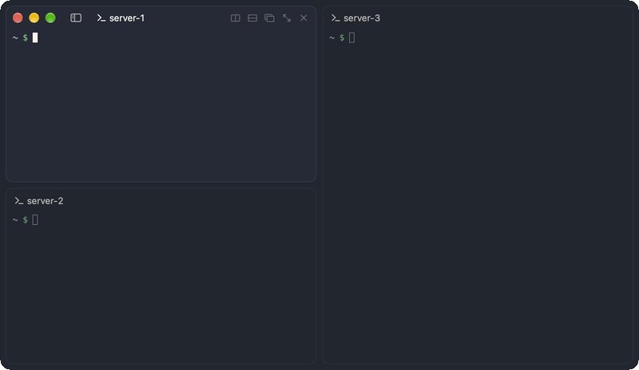

# rex-broadcast

[](https://github.com/jellynugget/rex-broadcast/actions/workflows/test.yml)

Broadcast input for the [Rex](https://www.superlogical.com/rex) terminal: type
once, and every pane in the tab gets the keys. Like `synchronize-panes` in
tmux or Broadcast Input in iTerm2. It is a Rex config module in Lua.



## Use

Press `cmd+shift+i` to start broadcasting in the current tab. Press it again
to stop. While it is on, each pane header shows
**((•)) Broadcasting · ⇧⌘I to stop**.

- Broadcasting stays with its tab. In other tabs, keys go to the focused pane
  as usual.
- Letters, digits, punctuation, `enter`, `tab`, `escape`, `backspace`,
  arrows, `home`/`end` and `pageup`/`pagedown` are broadcast. `cmd`
  shortcuts work as usual.
- The command palette has **Broadcast: Start**, **Stop** and **Toggle**.

## Install

Requires Rex for macOS.

```sh
git clone https://github.com/jellynugget/rex-broadcast ~/github/rex-broadcast
cd ~/github/rex-broadcast
./install.sh              # ./install.sh --uninstall to remove
```

`install.sh` links `broadcast.lua` into `~/.config/rex`, adds
`require("broadcast").setup()` to `init.lua`, and reloads Rex. To update, run
`git pull`, then `rex config reload`.

## Options

```lua
require("broadcast").setup{
  key = "cmd+shift+i",  -- starts and stops broadcasting
  stop_key = false,     -- another key that stops it, such as "escape"
}
```

The header shows the stop key, such as **⌃B to stop** for `key = "ctrl+b"`.

## How it works

Each typing key is bound to a Lua function. While broadcasting is off, the
function returns `false` and Rex handles the key as usual. While it is on, the
function writes the key's bytes to every terminal in the tab. The header note
goes in each pane's label, and the original label comes back when you stop.
State is saved in `.broadcast-state.json`, so it lasts through a config
reload.

## Limits

- Paste, input methods (emoji, CJK) and the mouse are not broadcast.
- Punctuation assumes a US keyboard layout.
- While broadcasting, pane headers don't follow `cd` or a new program.
- The icon is an Apple SF Symbol. If it shows as a box, change `ICON` in
  `broadcast.lua`.

## Development

```sh
bash test/run.sh             # unit tests with a fake rex, and shellcheck (CI)
bash test/e2e.sh             # end-to-end, against your running Rex
bash scripts/record-demo.sh  # record docs/demo.gif
```

## License

[MIT](LICENSE)
